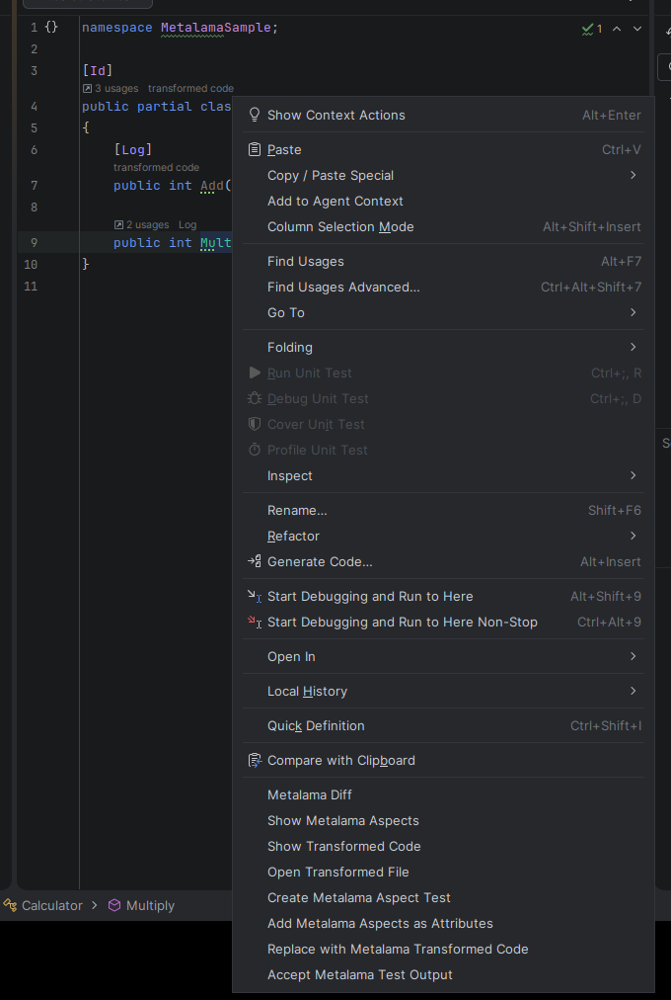
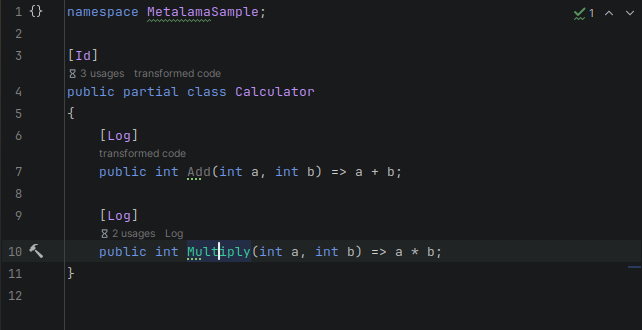
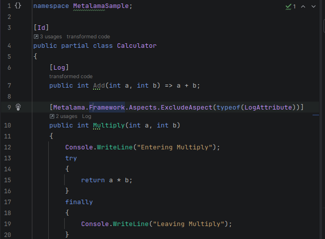
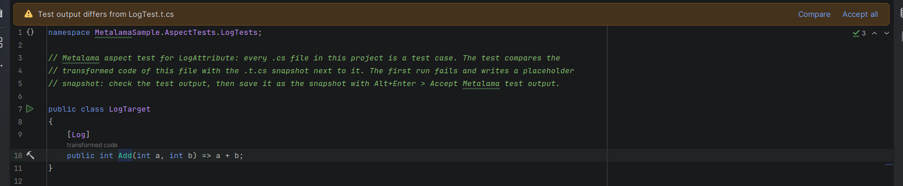
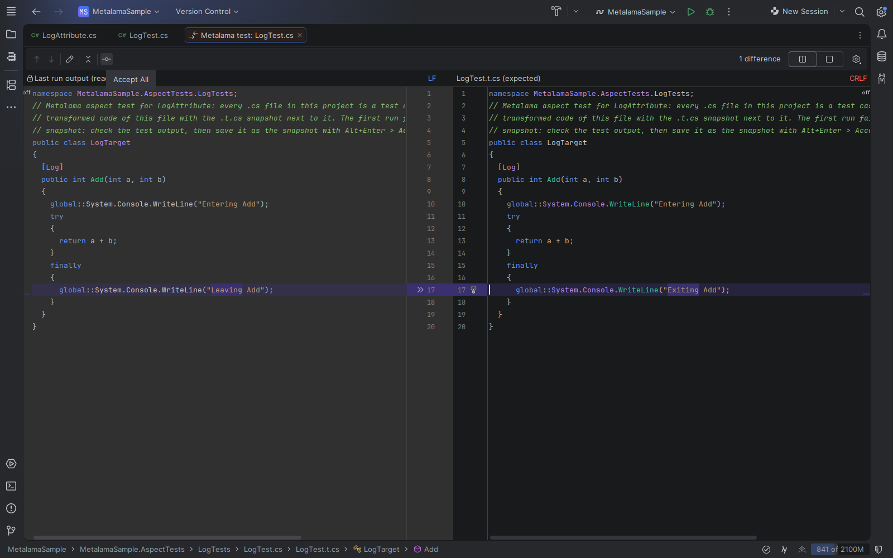
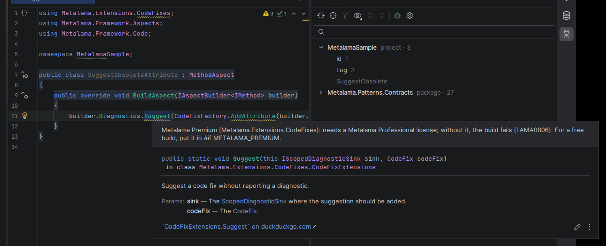

<p align="center">
  <br>
  
</p>

# LamaRider

Metalama tooling for JetBrains Rider — the Rider counterpart of the Visual Studio extension
"PostSharp / Metalama Tools" (`PostSharpTechnologies.PostSharp`).

| Feature | What you get |
|---|---|
| **LamaRider tool window** | Every aspect class of the solution and its packages, filtered and grouped; documentation and *Go to source* (also for library aspects). The targets of the selected aspect with transformations and diagnostics. *Track Caret* shows the aspects at the caret. Refreshes on its own. |
| **Code Vision** | Above declarations: the aspects a fabric, inheritance etc. adds (`Log`, or `N aspects`), `transformed code`, and `applied to N targets` on aspect classes. Tooltips say where an aspect comes from. Inlay hints for aspects on parameters and return values (`int NonNegative Multiply`). A click opens the transformed code or a menu of the aspects. Can show only counts instead. |
| **Aspects into code** | Alt+Enter on a declaration name: *Add [Log] as attribute* writes an aspect a fabric etc. adds as an attribute. *Replace with transformed code* is `metalama divorce` for one declaration. Also in the editor menu. |
| **Transformed code** | *Show Transformed Code*: one declaration after all aspects, in a popup, with a diff toggle. *Metalama Diff* (`Ctrl+K, 0` in the Visual Studio keymap): the whole file, source vs transformed. |
| **T# highlighting** | Compile-time code in templates is tinted; `meta.*` and compile-time variables stand out. |
| **Metalama errors** | Errors such as LAMA0037 underlined seconds after a save, also while Rider's Metalama analysis waits for a build (LAMA0118). Errors without a location in an info bar. Alt+Enter: LAMA documentation, build to resume analysis. |
| **Debug transformed code** | *Debug with LamaDebug* adds and selects a `LamaDebug` configuration and debugs the transformed code. Or debug transformed code in every configuration. |
| **Aspect tests** | Alt+Enter on an aspect › *Create Metalama aspect test*. Run / debug from the gutter. When the output differs from the `.t.cs`, an info bar offers *Compare* and *Accept all*. Breakpoints in aspects, templates and fabrics stop while debugging. Sets up Rider's Test Runner discovery. |
| **Metalama Premium code** | Warning on every use of a Premium component (`CodeFixFactory`, validation, architecture, Azure / Redis caching), which needs a Metalama Professional license. Alt+Enter: *Put it in #if METALAMA_PREMIUM*, *Set up free and Premium builds* (`-p:MetalamaPremium=true` for the licensed build). |

PostSharp classic (MSIL) projects are not supported. **How to use each feature, and its limitations:
[docs/usage.md](docs/usage.md).**

## Screenshots


The LamaRider tool window (llama icon, right tool window bar) with the `Log` aspect selected: documentation, *Go to
source*, and its targets with their transformations.


*Track Caret*: every aspect on `Multiply`, its parameters and its class.


Code Vision: `transformed code`, `Log` (added by a fabric), and inlay hints for the `NonNegative` aspects on the return
value and parameters.


Clicking an aspect name: Metalama Diff and the aspects grouped by member, parameter and return value.


*Show Transformed Code*: `Add` after the `Log` aspect, with a diff toggle and links to the aspects.


*Metalama Diff*: the source next to the whole transformed file.



The editor menu: *Add Metalama Aspects as Attributes* and *Replace with Metalama Transformed Code*.



*Add [Log] as attribute*: `[Log]` with the aspect's settings.



*Replace with transformed code*: `Multiply` is now the code `Log` generated, and `ExcludeAspect` keeps the fabric from
adding `Log` again.


T# highlighting: compile-time code stands out from the code the template generates.


A Metalama error without a location (an exception in a fabric, LAMA0041) in an info bar, and underlined on the aspect
classes.


Debugging transformed code: the `Log` aspect's `Console.WriteLine` calls are real lines.


A new aspect test from *Create Metalama aspect test*.


An aspect test: the gutter icon runs or debugs it.



Test output differs from the `.t.cs` snapshot: *Compare* or *Accept all*.



*Compare*: the last run's output (left) against the `.t.cs` (right); take single changes or *Accept All*.


*Debug Metalama Aspect Test* stopped at a breakpoint in `LogAttribute.cs`, with your file side by side.



A Metalama Premium API warning: Alt+Enter puts the code in `#if METALAMA_PREMIUM` or sets up free and Premium builds.


*Settings › Tools › LamaRider* (or the settings icon in the tool window): Code Vision display, build on save,
debugging, and the Rider setup for aspect tests.

## Requirements

- Rider 2026.2 or 2026.3.
- .NET SDK 8.0 or newer on `PATH`.
- Solutions referencing `Metalama.Framework` 2026.x, restored at least once.
- Metalama's Premium components (`Metalama.Extensions.CodeFixes`, architecture validation, Azure / Redis caching) need a
  Metalama Professional license; without one the build fails with LAMA0806. See
  [Licensing](docs/usage.md#licensing) and [Metalama Premium code](docs/usage.md#metalama-premium-code).

## How it works

The backend (ReSharper plugin) runs **LamaRider.Worker** out of process. The worker uses Metalama's
`Metalama.Framework.Workspaces` API and writes its results to `%LOCALAPPDATA%\LamaRider\out\`. It is built on first use
for your Metalama version (cached in `%LOCALAPPDATA%\LamaRider\worker\`), so the first refresh takes a minute. It
refreshes after file changes, builds and package restores, and logs to `%LOCALAPPDATA%\LamaRider\logs\last-run.log`.

## Build and install

```bash
./gradlew buildPlugin
```

Install `build/distributions/LamaRider-<version>.zip` via *Settings › Plugins › ⚙ › Install Plugin from Disk…*.

Try it in a sandboxed Rider with the bundled sample:

```bash
./gradlew runIde -PopenSolution=samples/MetalamaSample/MetalamaSample.sln
```

`ProductVersion` (Rider, frontend), `SdkVersion` (`JetBrains.Rider.SDK`, backend) and `SinceBuild` in
`gradle.properties` set the Rider to build against. The default (2026.2.3) also runs in 2026.3. To build against 2026.3:

```bash
./gradlew buildPlugin -PProductVersion=2026.3-EAP6-SNAPSHOT -PSdkVersion=2026.3.0-eap06 -PSinceBuild=263
```

### Automatic updates from a local plugin repository

```bash
./gradlew publishLocal
```

Builds the plugin as `<PluginVersion>.<yyMMddHHmm>` into `~/.lamarider/plugin-repo/` (or `-PlocalRepoDir=<dir>`) with
an `updatePlugins.xml`. Add the printed URL once in *Settings › Plugins › ⚙ › Manage Plugin Repositories…*; Rider then
offers every `publishLocal` build as an update.

## Tests

```bash
dotnet test LamaRider.sln
```

```bash
./gradlew unitTest
```

UI tests in a real Rider (Rider from `LAMARIDER_RIDER`; on Linux under `xvfb-run -a -s "-screen 0 1920x1080x24"`):

```bash
./gradlew uiTest
```

The UI test framework is pinned to 2026.3. Testing against Rider 2026.2 needs the coroutines jar of a 2026.3 Rider:

```bash
LAMARIDER_RIDER=<Rider 2026.2> xvfb-run -a -s "-screen 0 1920x1080x24" ./gradlew uiTest   -PuiTestCoroutinesJar=<Rider 2026.3>/lib/intellij.libraries.kotlinx.coroutines.core.jar
```

### Screenshots

`ScreenshotsUiTest` takes the images in `docs/screenshots` (all but `tsharp-color-settings.png`, taken by hand); the
normal `uiTest` run leaves it out:

```bash
xvfb-run -a -s "-screen 0 1920x1080x24" ./gradlew uiTest -PuiTestScreenshots
cp build/screenshots/*.png docs/screenshots/
```

Keep the file names (README, docs/usage.md and the plugin description use them) and a short caption under every
screenshot in this README.

## Plugin description

The Marketplace / *Settings › Plugins* description comes from [docs/plugin-description.html](docs/plugin-description.html).
Its screenshots use `ScreenshotBaseUrl` in `gradle.properties`
(`https://raw.githubusercontent.com/wollume-studios/LamaRider/main/docs/screenshots`); empty leaves the images out.

## Publishing to JetBrains Marketplace

The first version is uploaded by hand on plugins.jetbrains.com. Later versions: run the *Publish to JetBrains Marketplace*
workflow (GitHub Actions, channel `eap` by default, secret `JETBRAINS_MARKETPLACE`), push a `v*` tag, or run
`PUBLISH_TOKEN=<token> ./gradlew publishPlugin` (`-PPublishChannel=<name>` for another channel). Users of the `eap`
channel add `https://plugins.jetbrains.com/plugins/eap/list` as a custom plugin repository.

## Layout

```
protocol/            rd model shared by backend and frontend
src/dotnet/LamaRider backend: model host, worker runner, Code Vision, T# highlighting
src/rider/           frontend: Aspect Explorer, Code Vision popup, Metalama Diff
src/worker/          LamaRider.Worker (Metalama introspection)
samples/             MetalamaSample fixture used by the tests
tests/               worker and model tests
```
