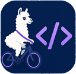

<p align="center">
  <br>
  
</p>

# LamaRider

Metalama tooling for JetBrains Rider — the Rider counterpart of the Visual Studio extension
"PostSharp / Metalama Tools" (`PostSharpTechnologies.PostSharp`).

| Feature | What you get |
|---|---|
| **LamaRider tool window** | Right side bar (llama icon): every aspect class of the solution and its packages, filtered by name and grouped by project/package, by namespace or not at all; documentation and *Go to source* (also for library aspects: sources or decompiled); the targets of the selected aspect as Project › Namespace › Type › Member with transformations and diagnostics. *Track Caret* shows the aspects affecting the code at the caret instead. Refreshes on its own after saves, builds and package changes. |
| **Code Vision** | Above every declaration an aspect touches: one entry per aspect added by a fabric, inheritance etc. (`Log`, `NonNegative`), `N aspects` for more than two, `transformed code` when all its aspects are attributes you see anyway; `applied to N targets` on aspect classes. The tooltip says where the aspect comes from (the fabric's full name, or the aspect it is inherited from, added or required by) and gives its documentation. Aspects a fabric or inheritance puts on a parameter get an inlay hint per aspect after the parameter. A click on `transformed code` opens the transformed code; on aspect names, a menu with the transformed code, Metalama Diff and the aspects grouped by member, parameter and return value. Clicking an aspect goes to its source, shows it in the LamaRider window, or asks (*Settings › Tools › LamaRider*). |
| **Transformed code** | *Show Transformed Code* (Code Vision, editor menu): the declaration after all aspects in a popup, highlighted, with a toggle to diff it with the source, *Whole File in Metalama Diff*, and links to the aspects that changed it. *Metalama Diff* (editor / Solution Explorer menu, `Ctrl+K, 0` in the Visual Studio keymap): the whole file, source vs transformed. |
| **T# highlighting** | Compile-time code in templates is tinted, `meta.*` and compile-time variables stand out. Colors: *Settings › Editor › Color Scheme › Metalama T#*. |
| **Metalama errors** | Errors such as LAMA0037 are underlined from LamaRider's own analysis seconds after a save, also while Rider's own Metalama analysis waits for a build (LAMA0118). Errors without a location (e.g. an exception in a fabric) show in an info bar on C# editors and on your aspect classes. Alt+Enter: LAMA documentation, *Build project to resume Metalama analysis*; optional build on save. |
| **Debug transformed code** | *Debug with LamaDebug* (tool window): selects Metalama's `LamaDebug` configuration, adding it to the `.sln`/`.slnx` first if needed, and starts debugging the transformed code. Or debug transformed code in every configuration (*Settings › Tools › LamaRider*), with or without formatting it (LAMA0066). |
| **Aspect tests** | Alt+Enter on an aspect class › *Create Metalama aspect test*: a prefilled test in the aspect test project next to the aspect's project, created when missing. Run / debug it from the gutter icon or the context menus, then *Accept Metalama Test Output* saves the `.t.cs` snapshot. Breakpoints in your aspects, templates and fabrics stop while debugging. Rider's Test Runner discovery, which aspect tests need, is set up for you. |

PostSharp classic (MSIL) projects are not supported. **How to use each feature, step by step, and its limitations:
[docs/usage.md](docs/usage.md).**

## Screenshots


The LamaRider tool window (right) with the `Log` aspect selected: *Go to source*, its documentation, and its targets in
the solution and in the aspect test project, with the transformations it makes. Open it from the llama icon in the right
tool window bar.


*Track Caret* (locate icon in the LamaRider toolbar): the targets tree follows the caret and lists every aspect on
`Multiply`, its parameters and its class.


Code Vision on the sample: `transformed code` on the declarations with aspect attributes, one entry each for `Log` and
`NonNegative` (its return value) on a method a fabric targets, and `NonNegative` hints after its parameters (hover them
for the fabric's name and the aspect's documentation). Shown on any C# file
once LamaRider has analyzed it.


Click an aspect name in Code Vision (or *Show Metalama Aspects* in the editor menu): the transformed code, Metalama Diff
and the aspects grouped by member and parameter, with their origin. Clicking an aspect goes to its source by default.


*Show Transformed Code* (a click on `transformed code`, or the editor menu): `Add` after the `Log` aspect. The toolbar
switches to a diff with the source or opens the whole file in Metalama Diff; the links at the bottom lead to the aspects.


*Metalama Diff* (right-click a `.cs` file in the editor or Solution Explorer): the source next to the whole transformed
file.


T# highlighting in an aspect: compile-time code (`meta.Target.Method.Name`, `meta.Proceed()`, the compile-time variable
`name`) stands out from the code the template generates. Colors in *Settings › Editor › Color Scheme › Metalama T#*.


A Metalama error without a location (here an exception in a fabric, LAMA0041): an info bar on every C# editor with the
LAMA documentation and a build, and the error underlined on the aspect classes.


Stepping into `Multiply` lands in its transformed code (the `Log` aspect's `Console.WriteLine` calls are real lines
there). Use *Debug with LamaDebug* in the LamaRider tool window, or turn on *Debug transformed code in every build
configuration* in the settings and debug as usual.


A new aspect test from Alt+Enter on `LogAttribute` › *Create Metalama aspect test*: `LogTests/LogTest.cs` in the aspect
test project, with a target that already uses `[Log]`.


An aspect test file: the gutter icon runs or debugs it, and Code Vision shows what the aspect does to the test input.


*Debug Metalama Aspect Test*: stopped at a breakpoint set in `LogAttribute.cs`. The debugger shows Metalama's compiled
copy of the aspect; the info bar opens your file at the same line.


*Settings › Tools › LamaRider* (or the settings icon in the LamaRider tool window): what clicking an aspect does, build on
save, debugging transformed code, formatting it, and whether Rider is set up for aspect tests.

## Requirements

- Rider 2026.2 or 2026.3 (one plugin build for both: built against 2026.2.3, since-build 262). Rider 2026.1 is not
  supported: it lacks an API LamaRider uses (`ISolution.ToDataContext2`).
- .NET SDK on `PATH` (8.0 or newer).
- Solutions referencing `Metalama.Framework` 2026.x, restored at least once (`obj/project.assets.json` must exist).
- No Metalama license needed: everything runs on the open-source Metalama framework.

## How it works

The backend (ReSharper plugin) detects the solution's Metalama version and runs **LamaRider.Worker** out of process.
The worker uses Metalama's `Metalama.Framework.Workspaces` introspection API and Metalama's own T# classifier, and
writes `model.json` plus the transformed files to `%LOCALAPPDATA%\LamaRider\out\`. It is built from source on first
use against your Metalama version (cached in `%LOCALAPPDATA%\LamaRider\worker\`), so the first refresh takes a minute.

Data refreshes on solution load, about a second after code, project or package files change, after every build, and via
the Refresh button in the LamaRider tool window. Between refreshes, results reflect the last one. Worker output is logged
to `%LOCALAPPDATA%\LamaRider\logs\last-run.log`.

## Build and install

```bash
./gradlew buildPlugin
```

Install `build/distributions/LamaRider-<version>.zip` via *Settings › Plugins › ⚙ › Install Plugin from Disk…*.

The Rider to build against is set by three Gradle properties in `gradle.properties`: `ProductVersion` (Rider, frontend),
`SdkVersion` (`JetBrains.Rider.SDK`, backend) and `SinceBuild` (first build the plugin installs in). The default
(2026.2.3, 2026.2.3.1, 262) also runs in 2026.3. To build against 2026.3 instead:

```bash
./gradlew buildPlugin -PProductVersion=2026.3-EAP6-SNAPSHOT -PSdkVersion=2026.3.0-eap06 -PSinceBuild=263
```

### Automatic updates from a local plugin repository

```bash
./gradlew publishLocal
```

Builds the plugin with a fresh version (`<PluginVersion>.<yyMMddHHmm>`), copies it to `~/.lamarider/plugin-repo/`
(override with `-PlocalRepoDir=<dir>`, e.g. a network share) and writes `updatePlugins.xml` there. Once, in Rider:
*Settings › Plugins › ⚙ › Manage Plugin Repositories… › +* and add the printed URL, e.g.
`file:///C:/Users/<you>/.lamarider/plugin-repo/updatePlugins.xml`. Rider then offers every `publishLocal` build as
a plugin update.

### JetBrains Marketplace

`PUBLISH_TOKEN=<token> ./gradlew publishPlugin` uploads to the `eap` channel (`-PPublishChannel=<name>` for another).
The very first upload of a new plugin has to be done by hand on plugins.jetbrains.com.

Try it in a sandboxed Rider with the bundled sample:

```bash
./gradlew runIde -PopenSolution=samples/MetalamaSample/MetalamaSample.sln
```

## Tests

```bash
dotnet test LamaRider.sln
```

```bash
./gradlew unitTest
```

UI tests in a real Rider (Rider from `LAMARIDER_RIDER`; on Linux under `xvfb-run -a -s "-screen 0 1920x1080x24"`):

```bash
./gradlew uiTest
```

The UI test framework (Starter/Driver) is pinned to 2026.3, whatever `ProductVersion` builds the plugin. It needs
JetBrains' coroutines library, which UI tests take from the Rider under test (`LAMARIDER_RIDER`). Rider 2026.2 does not
ship the version Starter needs, so testing against 2026.2 needs a 2026.3 Rider's jar via `-PuiTestCoroutinesJar`:

```bash
LAMARIDER_RIDER=<Rider 2026.2> xvfb-run -a -s "-screen 0 1920x1080x24" ./gradlew uiTest   -PuiTestCoroutinesJar=<Rider 2026.3>/lib/intellij.libraries.kotlinx.coroutines.core.jar
```

### Screenshots

The images in `docs/screenshots` are taken by `ScreenshotsUiTest` on the sample solution (Linux, Xvfb), which the
normal `uiTest` run leaves out (all but `tsharp-color-settings.png`, which is taken by hand):

```bash
xvfb-run -a -s "-screen 0 1920x1080x24" ./gradlew uiTest -PuiTestScreenshots
cp build/screenshots/*.png docs/screenshots/
```

Keep the file names (README, docs/usage.md and the plugin description use them) and a short caption under every
screenshot in this README: what you see and how to get there.

## Plugin description

The Marketplace / *Settings › Plugins* description comes from [docs/plugin-description.html](docs/plugin-description.html).
Its screenshots need public URLs: set `ScreenshotBaseUrl` in `gradle.properties` (for a public GitHub repo:
`https://raw.githubusercontent.com/wollume-studios/LamaRider/main/docs/screenshots`); while it is empty the description
is built without images.

## Publishing to JetBrains Marketplace

The first version is uploaded by hand on plugins.jetbrains.com. Later versions: run the *Publish to JetBrains Marketplace*
workflow (GitHub Actions, channel `eap` by default) or push a `v*` tag. It uses the `JETBRAINS_MARKETPLACE` repository secret.
Users of the `eap` channel add `https://plugins.jetbrains.com/plugins/eap/list` as a custom plugin repository.

## Layout

```
protocol/            rd model shared by backend and frontend
src/dotnet/LamaRider backend: model host, worker runner, Code Vision, T# highlighting
src/rider/           frontend: Aspect Explorer, Code Vision popup, Metalama Diff
src/worker/          LamaRider.Worker (Metalama introspection)
samples/             MetalamaSample fixture used by the tests
tests/               worker and model tests
```
