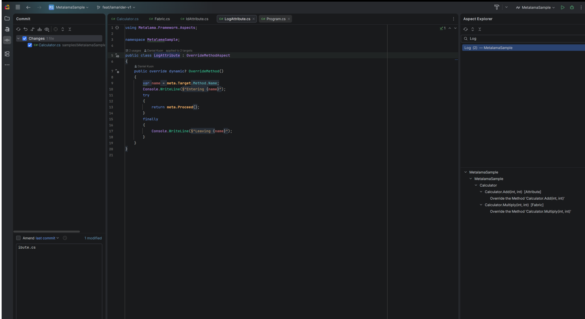
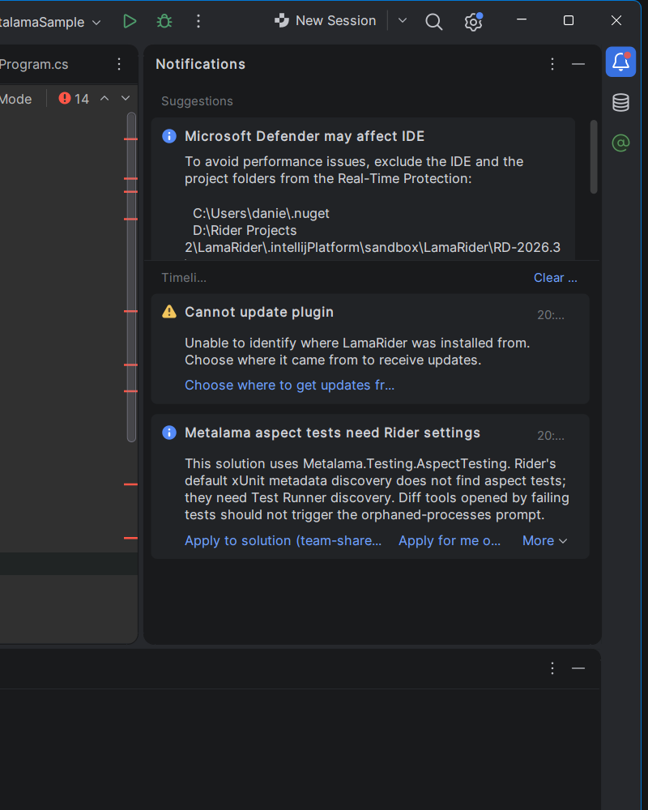
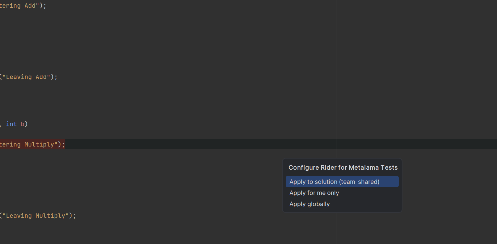
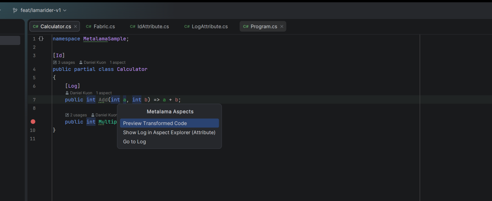

# LamaRider

Metalama tooling for JetBrains Rider — the Rider counterpart of the Visual Studio extension
"PostSharp / Metalama Tools" (`PostSharpTechnologies.PostSharp`).

| Feature | What you get |
|---|---|
| **Aspect Explorer** | Tool window (right): aspect classes in the solution; select one to see its targets as Project › Namespace › Type › Member with their transformations and diagnostics. Double-click navigates; a transformation opens the diff. |
| **Code Vision** | `N aspects` above every declaration an aspect touches (attribute, fabric, inheritance, child aspect); `applied to N targets` above aspect classes. Click for *Preview Transformed Code*, *Show in Aspect Explorer*, *Go to aspect*. |
| **T# highlighting** | Compile-time code in templates is tinted, `meta.*` and compile-time variables stand out. Colors: *Settings › Editor › Color Scheme › Metalama T#*. |
| **Metalama Diff** | Right-click a `.cs` file (editor or Solution Explorer) › *Metalama Diff*: source vs transformed code. `Ctrl+K, 0` in the Visual Studio keymap. |
| **Show Metalama Aspects** | Editor context menu / Find Action: the Code Vision popup for the declaration at the caret (keyboard access). |
| **Rider setup for aspect tests** | When a solution references `Metalama.Testing.AspectTesting` and xUnit discovery is still *Metadata* (Metalama's docs: aspect tests need *Test Runner* discovery), a notification offers to fix it — team-shared (`.sln.DotSettings`), personal, or global. It also stops the orphaned-processes prompt for diff tools that failing aspect tests open. Also on demand: *Tools › Configure Rider for Metalama Tests*. Rider 2026.3 already defaults to Test Runner, so usually nothing is needed. |
| **Debug transformed code** | *Tools › Debug Transformed Code* sets `MetalamaDebugTransformedCode` in the solution's `Directory.Build.props`; rebuild, then *Open Transformed File* (editor context menu) and set breakpoints in the transformed code. Toggle off to remove the setting again. |

PostSharp classic (MSIL) projects are not supported.

| Code Vision | T# highlighting |
|---|---|
|  |  |

| Aspect Explorer | Metalama Diff |
|---|---|
|  |  |

| Aspect-test settings | Configure on demand |
|---|---|
|  |  |

| Show Metalama Aspects | Debugging transformed code |
|---|---|
|  |  |

## Requirements

- Rider 2026.3 (build 263+, EAP6 or later).
- .NET SDK on `PATH` (8.0 or newer).
- Solutions referencing `Metalama.Framework` 2026.x, restored at least once (`obj/project.assets.json` must exist).
- No Metalama license needed: everything runs on the open-source Metalama framework.

## How it works

The backend (ReSharper plugin) detects the solution's Metalama version and runs **LamaRider.Worker** out of process.
The worker uses Metalama's `Metalama.Framework.Workspaces` introspection API and Metalama's own T# classifier, and
writes `model.json` plus the transformed files to `%LOCALAPPDATA%\LamaRider\out\`. It is built from source on first
use against your Metalama version (cached in `%LOCALAPPDATA%\LamaRider\worker\`), so the first refresh takes a minute.

Data refreshes on solution load, after every build, and via the Refresh button in the Aspect Explorer. Between
refreshes, results reflect the last build. Worker output is logged to `%LOCALAPPDATA%\LamaRider\logs\last-run.log`.

## Build and install

```bash
./gradlew buildPlugin
```

Install `build/distributions/LamaRider-<version>.zip` via *Settings › Plugins › ⚙ › Install Plugin from Disk…*.

Try it in a sandboxed Rider with the bundled sample:

```bash
./gradlew runIde -PopenSolution=samples/MetalamaSample/MetalamaSample.sln
```

## Tests

```bash
dotnet test LamaRider.sln
```

```bash
./gradlew unitTest
```

## Layout

```
protocol/            rd model shared by backend and frontend
src/dotnet/LamaRider backend: model host, worker runner, Code Vision, T# highlighting
src/rider/           frontend: Aspect Explorer, Code Vision popup, Metalama Diff
src/worker/          LamaRider.Worker (Metalama introspection)
samples/             MetalamaSample fixture used by the tests
tests/               worker and model tests
```
