# Using LamaRider

Step by step for every feature, and what it cannot do. For an overview with screenshots see the [README](../README.md).

- [Before you start](#before-you-start)
- [LamaRider tool window](#lamarider-tool-window)
- [Code Vision and parameter hints](#code-vision-and-parameter-hints)
- [Transformed code](#transformed-code): popup, Metalama Diff, Open Transformed File
- [T# highlighting](#t-highlighting)
- [Metalama errors](#metalama-errors)
- [Debugging transformed code](#debugging-transformed-code)
- [Aspect tests](#aspect-tests)
- [Settings](#settings)
- [Known limitations](#known-limitations)

## Before you start

- Rider 2026.3 (build 263, EAP6 or later), a .NET SDK 8.0 or newer on `PATH`.
- The solution references `Metalama.Framework` 2026.x and has been restored once (`obj/project.assets.json` exists).
  The Metalama version is read from there; with several versions in one solution, LamaRider uses one of them for all
  projects (and logs a warning).
- No Metalama license is needed.

LamaRider does not take its data from Rider's code model. A separate process, **LamaRider.Worker**, loads the solution
with Metalama's own introspection API (`Metalama.Framework.Workspaces`) and writes what it finds (aspects, targets,
transformations, diagnostics, transformed code) for the IDE to show. On first use the worker is built from source for
your Metalama version (cached in `%LOCALAPPDATA%\LamaRider\worker`, `~/.local/share/LamaRider/worker` on Linux), so the
first refresh takes about a minute. Later refreshes take seconds; the worker stays loaded between them.

A refresh starts on its own:

- when the solution is opened,
- about one second after a `.cs`, `.csproj`, `Directory.*.props` / `Directory.*.targets` file in the solution folder
  changes (saved in Rider or written by git or another tool), or after a NuGet restore,
- when a Rider build finishes,
- with *Refresh* in the LamaRider tool window.

Between refreshes everything shows the state of the last one. The worker's log is `%LOCALAPPDATA%\LamaRider\logs\last-run.log`.

## LamaRider tool window

Open it from the right tool window bar (llama icon), or with *Show in LamaRider* in a Code Vision popup.

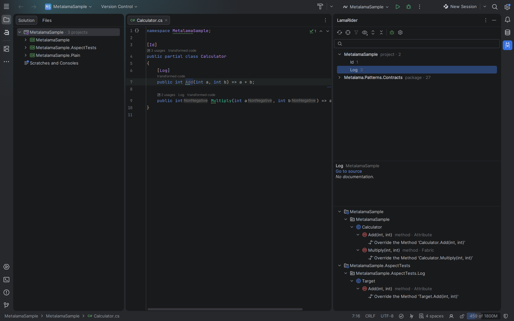

**Aspect list (top).** Every aspect class of the solution and of the referenced packages. The number after a class is
how many targets it has in the solution; classes without targets are grey.

1. Type in the search field to filter by class name.
2. *Group By* (toolbar): *Project / Package* (default: your projects first, then each package, collapsed),
   *Namespace*, or *Ungrouped*. The choice is remembered.
3. Select a class. The middle pane shows its XML documentation summary, *Go to source* and, for classes from
   Metalama's own packages, *Online documentation*. *Go to source* on a library aspect opens it like Ctrl+click in Rider
   does: SourceLink or symbol sources when available, otherwise decompiled code.

**Targets tree (bottom).** The selected class's targets as Project › Namespace › Type › Member, with an icon and kind
for each, how the aspect got there (*Attribute*, *Fabric*, *Inherited*, ...), the transformations it makes and the
diagnostics it reports there.

- Double-click a target to go to it.
- Double-click a transformation to see the transformed code of that declaration in a popup next to it (Metalama Diff of
  the whole file when there is no popup for it).
- Double-click a diagnostic to go to its line.

**Track Caret** (locate icon in the toolbar). The targets tree follows the caret instead of the selection: it shows
every aspect that affects the code at the caret, that is the member, its parameters and the types that contain it,
each target labelled with its aspect. Selecting an item there selects its aspect in the list and shows its
documentation. *Show Only Aspects at Caret* (filter icon, needs Track Caret) also reduces the aspect list to those
aspects. Both settings are remembered.

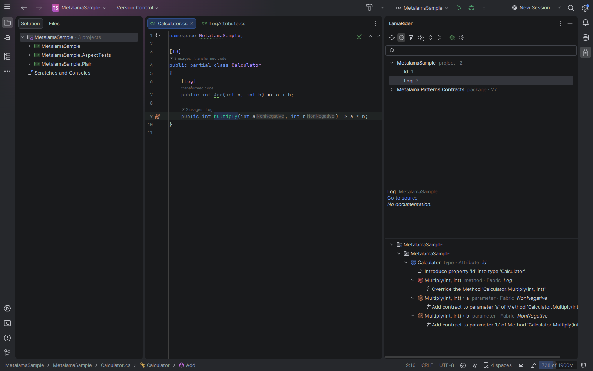

**Toolbar.** Refresh, Track Caret, Show Only Aspects at Caret, Group By, Expand / Collapse All (targets tree),
*Debug with LamaDebug* and LamaRider settings. The gear menu of the tool window has the LamaRider toggles
(*Debug Transformed Code*, *Build After Aspect Changes*, *Configure Rider for Metalama Tests*).

**Status line (bottom).** `Refreshed 14:02 · 29 aspects / 4 instances` after a refresh, with the number of Metalama
errors if there are any; `Refreshing (reason)…` while the worker runs; `No Metalama projects` when no project references
Metalama. When a refresh fails, the line starts with `Stale ·` (the data shown is from the last successful refresh) and
names the log file; the full text is in its tooltip.

Limitations:

- A refresh takes a few seconds, so the window lags behind typing; it shows what was saved, not what is in an unsaved editor.
- Projects that cannot be restored or loaded by MSBuild are missing (the reason is in the log).
- Aspect test projects are loaded a second time (see [Aspect tests](#aspect-tests)), which adds to the refresh time.

## Code Vision and parameter hints

Above every declaration an aspect touches, Code Vision says which aspects:

| Code Vision | Meaning |
|---|---|
| `transformed code` | Only aspects added by attributes, which you see in the code anyway. Click for the transformed code. |
| `Log (fabric)` | An aspect not visible in the code, with where it comes from: `fabric`, `inherited`, `child aspect`, `required aspect`. At most two are named. |
| `3 aspects` | More than two aspects not visible in the code (the count includes all aspects on the declaration). |
| `applied to 2 targets` | On an aspect class: how many targets it has in the solution. |

Aspects on a parameter that an attribute adds count for the member (the attribute is in the code). Aspects on a
parameter from a fabric, inheritance etc. get an **inlay hint** right after the parameter name, e.g. `a Positive (fabric)`.
Hover any of these for the full list.

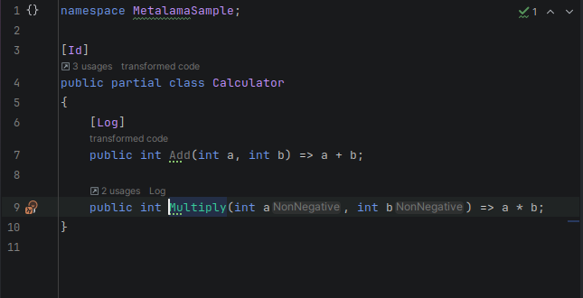

**Click** a Code Vision entry or a parameter hint (or use *Show Metalama Aspects* in the editor context menu or Find
Action for the declaration at the caret, without the mouse). The popup offers:

1. *Show Transformed Code*: the declaration after all aspects, see [below](#transformed-code).
2. *Metalama Diff (whole file)*.
3. The aspects, grouped by what they decorate: the member, each parameter (*Parameter a*), the return value. An aspect
   added by an attribute opens it in the LamaRider window; others have a submenu with *Show in LamaRider* and
   *Go to &lt;Aspect&gt;* (the class; for attribute aspects Ctrl+click on the attribute does that).
4. On an aspect class: *Show targets in LamaRider*.

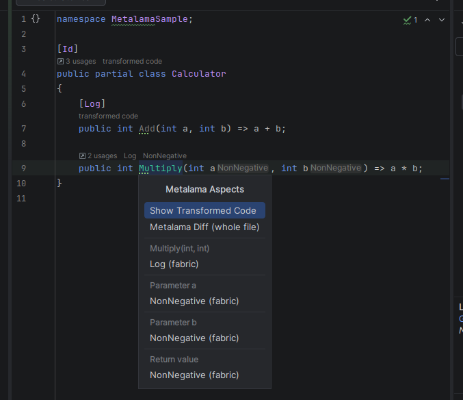

Limitations:

- Code Vision is per line, so aspects on parameters are hints after the parameter, not Code Vision entries.
- The counts come from the last refresh: a freshly added `[Log]` shows up after the save has been analyzed.

## Transformed code

**Transformed code popup.** From Code Vision (*Show Transformed Code*), the editor context menu / Find Action
(*Show Transformed Code*, for the declaration at the caret), or a double-click on a transformation in the LamaRider
window. The popup shows the declaration as Metalama compiles it, highlighted like the editor, with the aspects that
changed it at the bottom. The diff icon in its toolbar switches to source and transformed code side by side (the choice
is remembered); it is not offered for declarations an aspect introduced. The popup can be moved and resized.

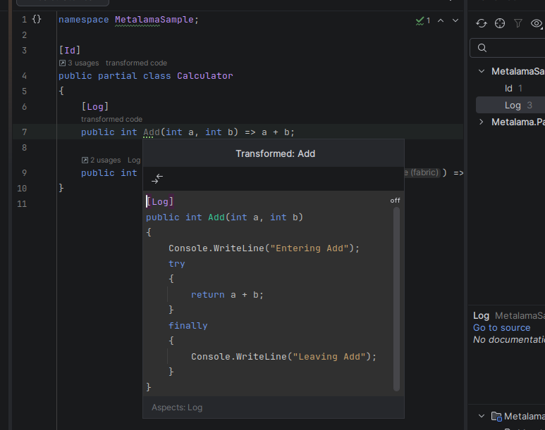

**Metalama Diff.** Right-click a `.cs` file in the editor or in Solution Explorer › *Metalama Diff* (Visual Studio
keymap: `Ctrl+K, 0`): Rider's diff viewer with the source on the left and the whole transformed file on the right
(read-only), scrolled to the caret.

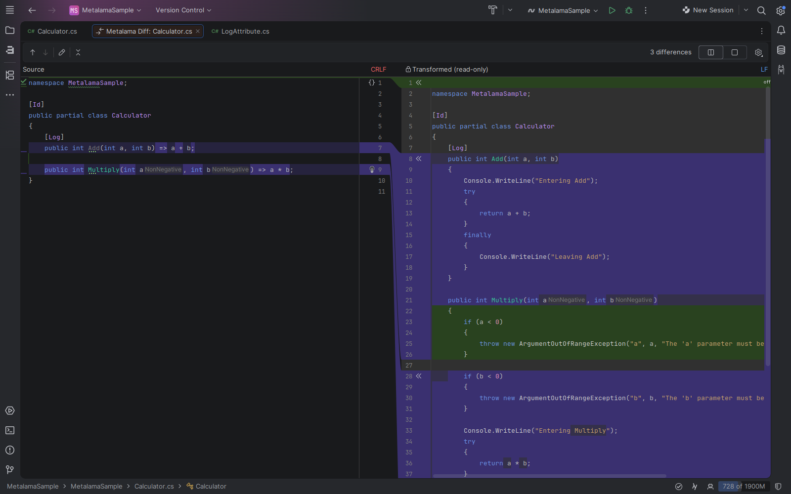

**Open Transformed File** (editor context menu) opens the transformed file Metalama wrote to `obj/` while
[debugging transformed code](#debugging-transformed-code) is on: the file the debugger uses then.

Limitations:

- The transformed code comes from the last refresh. LamaRider formats it like Metalama's own output, so it can differ
  in layout from what a LamaDebug build writes to `obj/`.
- Without a refresh result for a file (no aspects there, or the worker failed), Metalama Diff falls back to the
  transformed files of the last build in `obj/` and otherwise says there is nothing to show.

## T# highlighting

In aspect and template code, compile-time code is tinted, and `meta.*` calls and compile-time variables stand out, so
you see at a glance what runs at compile time and what becomes generated code. Colors:
*Settings › Editor › Color Scheme › Metalama T#*.

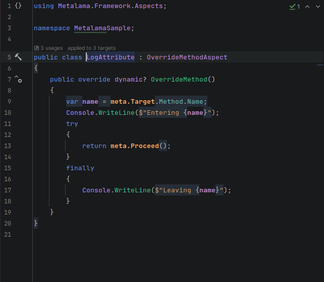

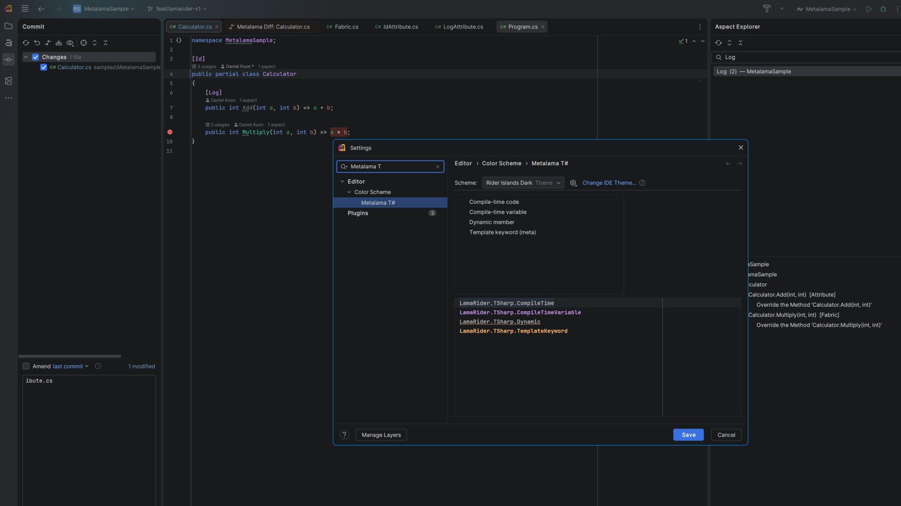

The classification is Metalama's own (from the worker), so it appears after the first refresh and follows the file as
of the last one.

## Metalama errors

- **Squiggles.** Metalama errors with a location, e.g. LAMA0037 (aspect not eligible) or a compile error in a
  template, are underlined from LamaRider's own analysis a few seconds after you save. Rider's own Metalama squiggles
  stop after compile-time code changed until the project is built (LAMA0118); LamaRider's keep coming.
- **Error info bar.** Errors without a location, which Metalama reports for the whole project (such as an exception in a
  fabric, LAMA0041, or LAMA0042 in aspect ordering), are shown in an info bar on every C# editor, with links to the
  *LAMAxxxx documentation* and *Build solution*. The tooltip lists all of them. The same errors are underlined on
  the names of your aspect classes in that project.
- **LAMA documentation.** Alt+Enter on an underlined LAMA error › *Open LAMAxxxx documentation* opens its page on
  doc.metalama.net.
- **Build to resume (LAMA0118).** Metalama pauses its design-time analysis in Rider after compile-time code changes,
  until the project is built. Alt+Enter anywhere in an aspect or template file › *Build '&lt;project&gt;' to resume
  Metalama analysis*. To do it automatically: *Settings › Tools › LamaRider › Build the project after aspect or template
  code is saved* (off by default; also in the tool window's gear menu as *Metalama: Build After Aspect Changes*).

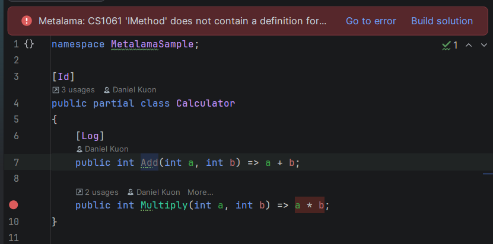

Limitations:

- Errors of aspect test inputs without a location are not shown (a test may expect them); located ones are.
- *Build to resume* is offered in every aspect and template file, whether or not Metalama has paused (Rider reports
  LAMA0118 from its Roslyn host, out of LamaRider's reach). Fabric files without templates do not get it.

## Debugging transformed code

Metalama's way to step through the code aspects generate is to build with `MetalamaDebugTransformedCode`. Two ways:

**Debug with LamaDebug** (LamaRider tool window toolbar or gear menu):

1. Click it. If the solution has no `LamaDebug` configuration, LamaRider asks to add one to the `.sln` / `.slnx`,
   copied from Debug (projects that do not use Metalama stay Debug). Wait until Rider has reloaded the solution, then
   click it again.
2. It selects LamaDebug and starts the selected run configuration in the debugger.
3. Step into a method an aspect changed, or set breakpoints in its transformed file: *Open Transformed File* in the
   editor context menu (`obj/LamaDebug/<tfm>/metalama/`).

**Every configuration:** *Settings › Tools › LamaRider › Debug transformed code in every build configuration* (or
*Debug Transformed Code* in the gear menu) writes `MetalamaDebugTransformedCode` to the solution's
`Directory.Build.props` (in a `LamaRider` property group; the rest of the file is kept). Rebuild, then debug as usual.

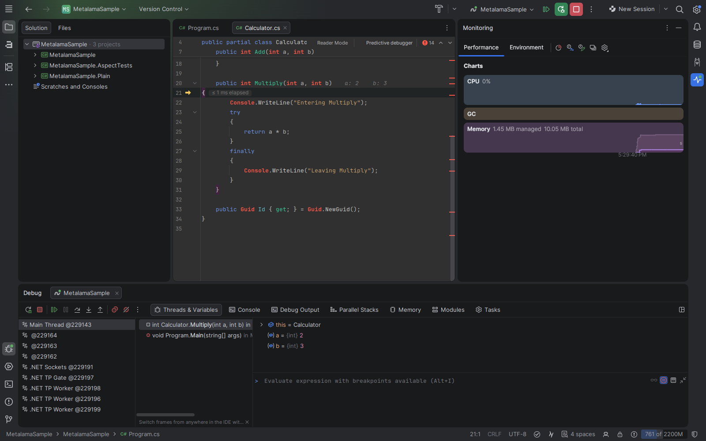

**Format transformed code** (same settings page, on by default): Metalama formats the transformed files it writes for
debugging, which is slower and makes it warn with LAMA0066. Off writes `MetalamaFormatOutput=false` to
`Directory.Build.props`: faster builds, no LAMA0066, less readable files in the debugger. LamaRider's popup and
Metalama Diff are formatted either way.

Limitations:

- Only the solution-level `Directory.Build.props` is changed; a project-level one stops MSBuild's upward search, so
  projects with their own `Directory.Build.props` don't see the setting unless it imports the parent one.
- Breakpoints in your source files don't stop in transformed code and vice versa: set them in the transformed file.
- Debugging your aspects themselves (templates, `BuildAspect`, fabrics) is a different thing, see
  [Aspect tests](#debug-an-aspect-test).

## Aspect tests

Metalama aspect tests (`Metalama.Testing.AspectTesting`) are snapshot tests: every `.cs` file in an aspect test project
is a test case, and the test compares its transformed code with the `.t.cs` file next to it.

### Create a test

1. In the aspect class, Alt+Enter on its name › *Create Metalama aspect test* (or editor context menu › *Create
   Metalama Aspect Test* with the caret in the class).
2. Pick where it goes: each aspect test project that references the aspect's project is offered; when there is none,
   *Create aspect test project '&lt;Project&gt;.AspectTests'*. A new project is created next to the aspect's project
   (xUnit, `Metalama.Testing.AspectTesting` of your Metalama version, the same target framework, central package
   management if the solution uses it) and added to the solution.
3. LamaRider writes `<Aspect>Tests/<Aspect>Test.cs` (then `<Aspect>Test2.cs`, ...) with the namespace Rider expects
   for that folder and a target that fits the aspect (a method for a method aspect, a type for a type aspect, ...), the
   aspect already applied. Aspects that are not attributes get a comment pointing to fabrics instead. The file opens,
   and the test project is built so Rider lists the test.

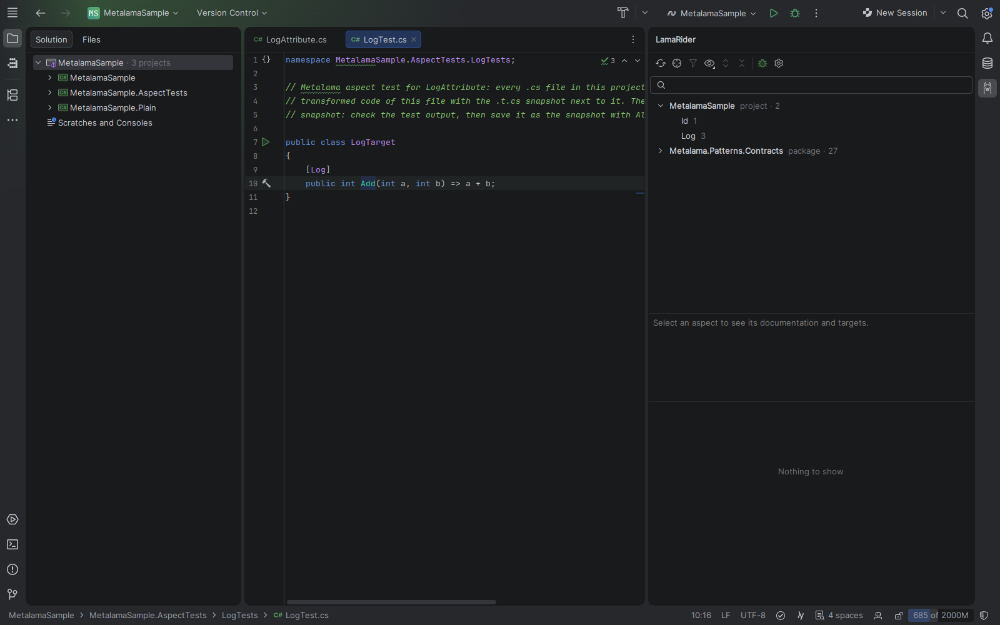

### Run and accept

1. Run the test: the run icon in the gutter of the test file, or *Run Metalama Aspect Test* in the editor or Solution
   Explorer context menu (also from Rider's Unit Tests window). Rider builds the project and discovers its tests first
   when it has not yet.
2. The first run fails: there is no snapshot yet. Check the transformed code in the test output.
3. In the test file, Alt+Enter › *Accept Metalama test output* (or editor context menu › *Accept Metalama Test Output*):
   the last run's output becomes the test's `.t.cs` snapshot. Run again: it passes.

Test inputs show their aspects like any other code: LamaRider window, Code Vision, Track Caret, transformed code. Rider
no longer greys them out as unused.

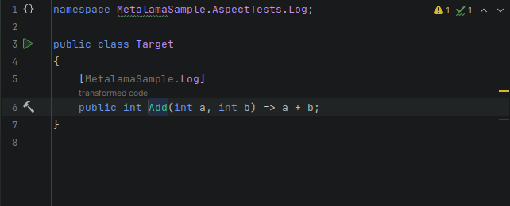

### Debug an aspect test

*Debug Metalama Aspect Test* (gutter icon, editor and Solution Explorer menus) runs the test in the debugger, and
**breakpoints in your aspects, templates and fabrics stop** - no `Debugger.Break()` or `meta.DebugBreak()` needed.

The debugger does not run your aspect source files: Metalama compiles a rewritten copy of the compile-time code (in its
temp folder), and that copy is where the debugger stops. When a debug session starts, LamaRider mirrors your enabled
breakpoints in compile-time code to the matching lines of that copy and removes them when the session ends. The copy
opens with an info bar *Metalama's compiled copy of LogAttribute.cs* and *Open LogAttribute.cs at this line* to get
back to your file.

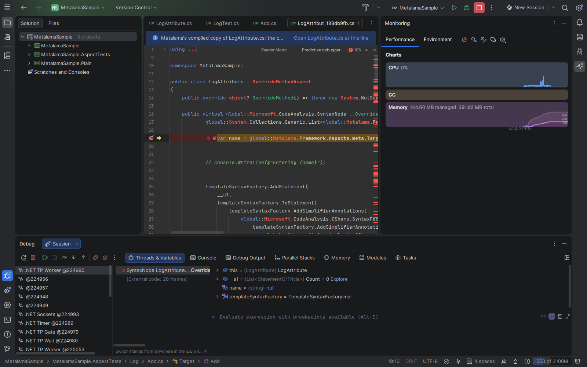

Limitations:

- Breakpoints added or changed during a session are mirrored at the next session.
- Mirroring reads Metalama's internal line map format (Metalama 2026.1) and watches for the test run's copy by polling.
  If Metalama changes the format or the copy is missed, the breakpoint simply doesn't stop, as without LamaRider.
- The debugger shows the compiled copy as Metalama wrote it (not reformatted, so its lines match the debugger), not your
  source file. The map has the lines with statements: a breakpoint on any other line is not mirrored.
- Rider's own debugger data-flow hints can log an internal error on that file (it is not part of the solution); it is
  harmless.
- `Metalama.Testing.AspectTesting` turns Metalama off in test projects (`MetalamaEnabled=False`). To show their aspects,
  LamaRider loads the aspect test projects a second time with Metalama on, which adds to the refresh time.

### Rider setup for aspect tests

Metalama's docs ask for two Rider settings for aspect tests: xUnit test discovery by *Test Runner* (discovery from
*Metadata* does not find aspect tests), and not prompting about orphaned processes for the diff tools failing aspect
tests open.

- When a solution uses `Metalama.Testing.AspectTesting` and discovery is still *Metadata*, a notification offers to
  apply them: *Apply to solution (team-shared)* (`.sln.DotSettings`), *Apply for me only* (`.sln.DotSettings.user`) or
  *Apply globally*.
- *Run / Debug Metalama Aspect Test* turns Test Runner discovery on in `.sln.DotSettings.user` when it is off.
- *Settings › Tools › LamaRider › Aspect Tests* shows whether the settings are in place (updated live) and has
  *Configure Rider for Metalama Tests…*.

Rider 2026.3 already defaults to Test Runner discovery, so usually nothing is needed.

## Settings

*Settings › Tools › LamaRider* (also the settings icon in the LamaRider tool window):

| Setting | Default | Effect |
|---|---|---|
| Build the project after aspect or template code is saved | off | Builds the saved file's project so Metalama's design-time analysis resumes (LAMA0118). For all solutions. |
| Debug transformed code in every build configuration | off | `MetalamaDebugTransformedCode` in the solution's `Directory.Build.props`. |
| Format transformed code | on | Off: `MetalamaFormatOutput=false` in `Directory.Build.props` (faster builds, no LAMA0066). |
| Aspect Tests | | Status of the Rider settings aspect tests need, and *Configure Rider for Metalama Tests…*. |

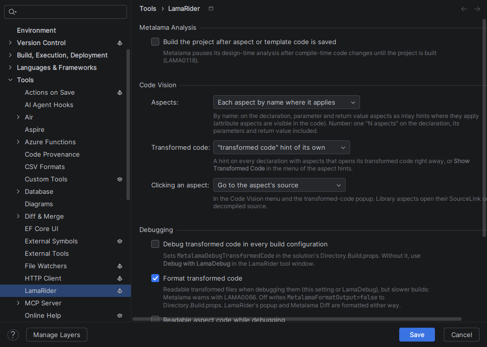

## Known limitations

- Rider 2026.3 and Metalama 2026.x only. PostSharp classic (MSIL) projects are not supported.
- All analysis runs out of process through Metalama Workspaces: a refresh takes seconds, the first one about a minute,
  and projects must be restorable and loadable by MSBuild.
- With several Metalama versions in one solution, one version is used for all projects.
- File paths are compared case-insensitively, also on Linux.
- Debugging aspects relies on Metalama's internal compiled-copy map format (2026.1); see
  [Debug an aspect test](#debug-an-aspect-test).
- Only the solution-level `Directory.Build.props` is written by the debugging settings.
